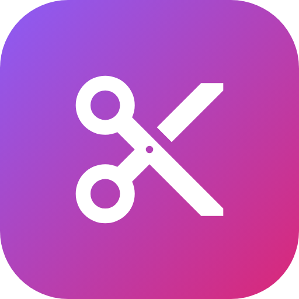
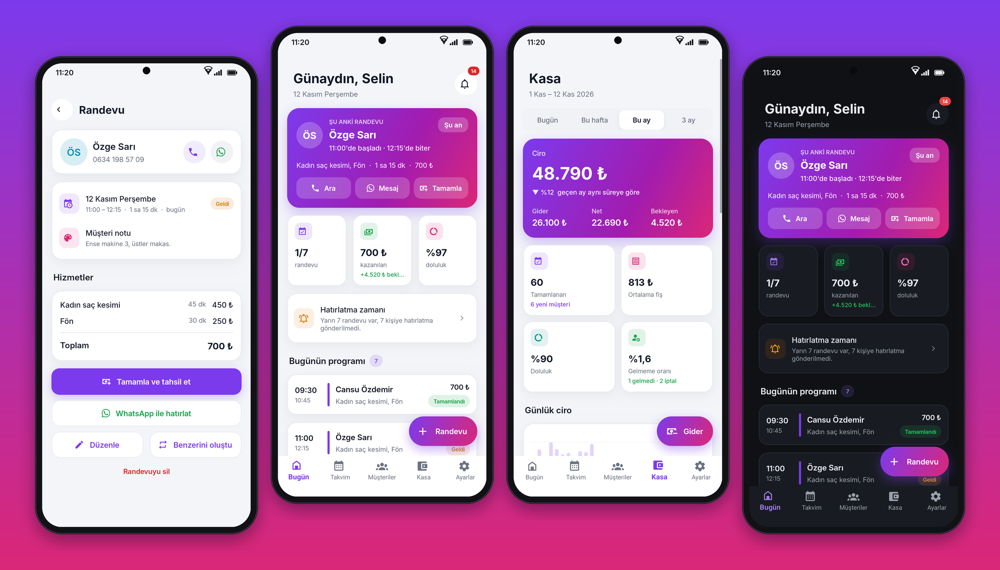
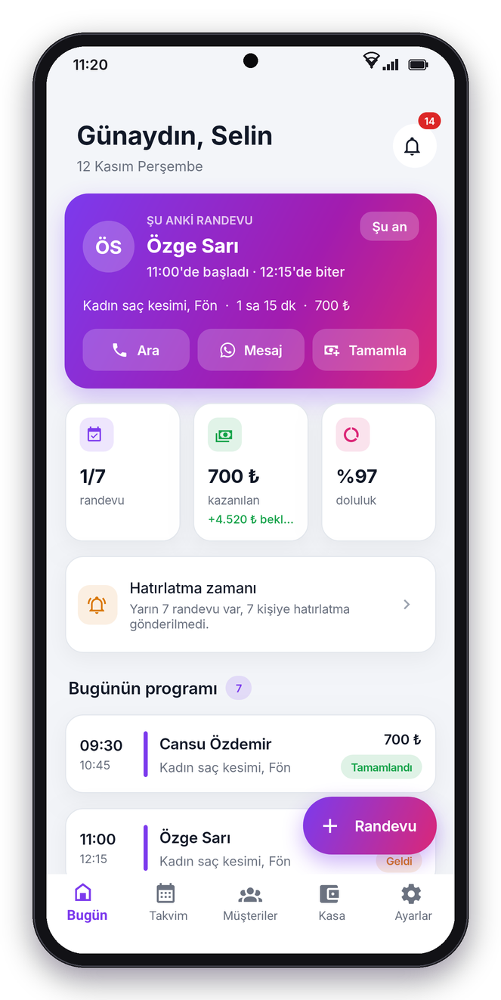
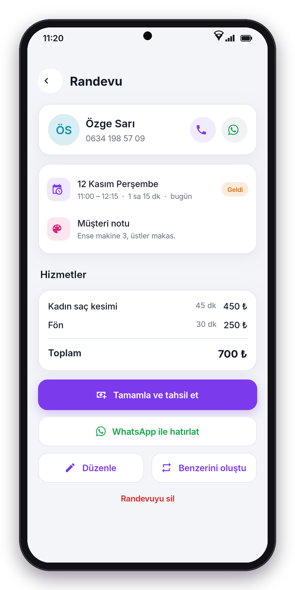
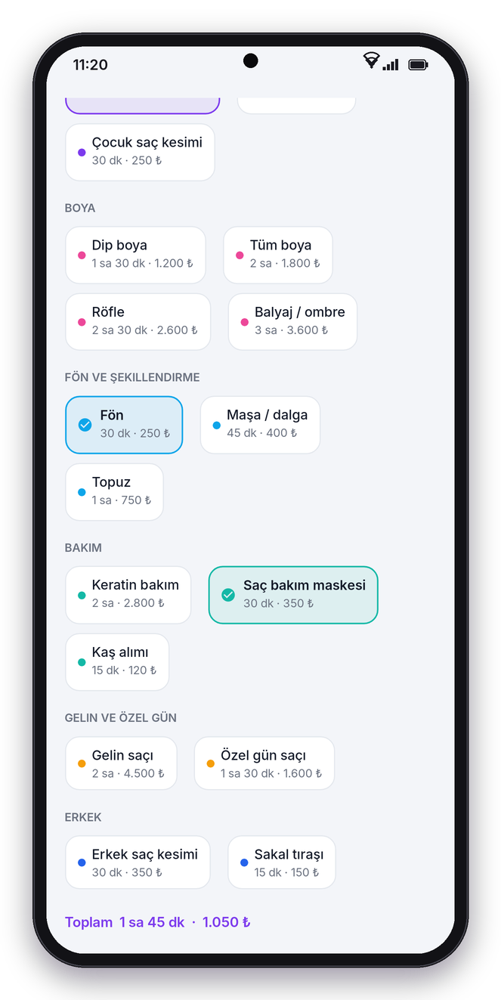
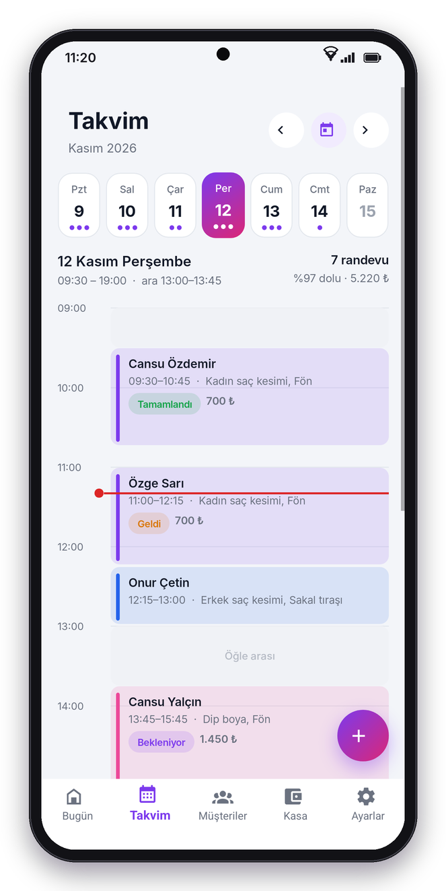
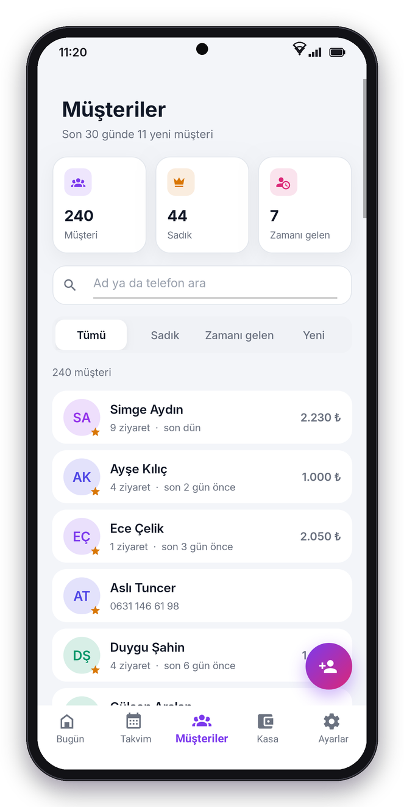
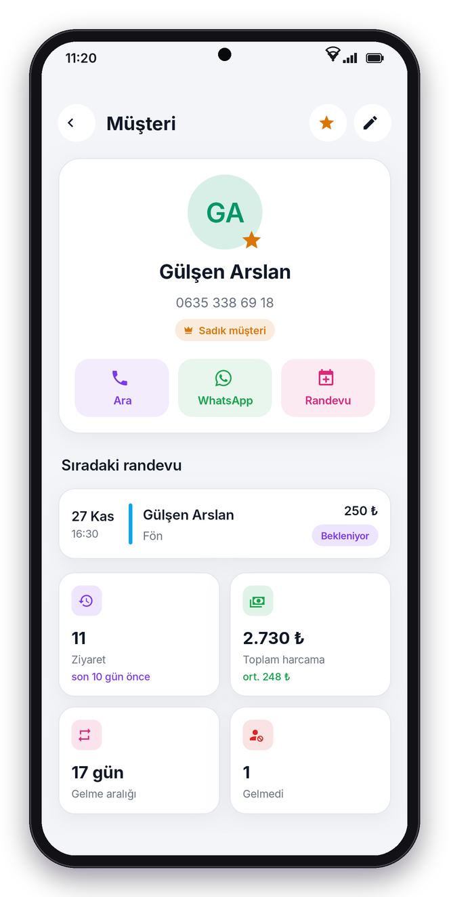
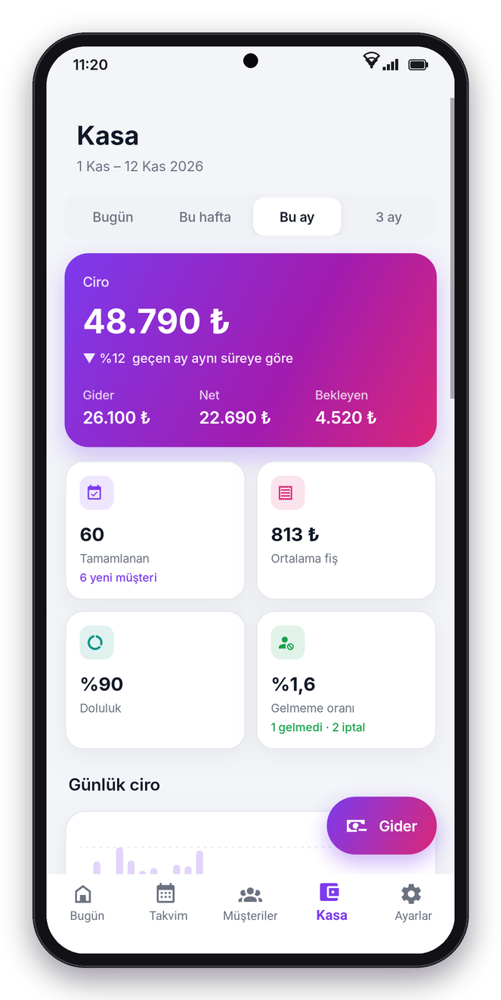
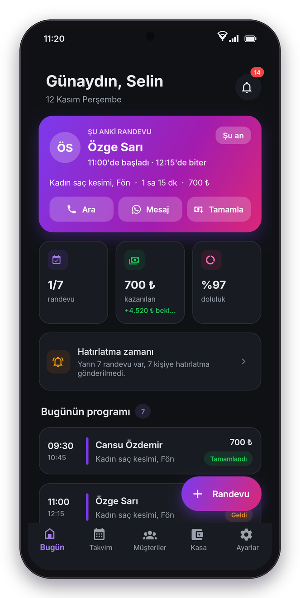

<p align="center">
  
</p>

<h1 align="center">OnderCode Kuaför</h1>

<p align="center">
  Tek başına, randevuyla çalışan kuaförler için <b>ücretsiz ve açık kaynak</b> Android uygulaması.<br>
  Randevu, müşteri, WhatsApp hatırlatma ve kasa takibi tek yerde. Hesap, reklam, abonelik yok.
</p>

<p align="center">
  <a href="https://ondercode.com/projeler/ondercode-kuafor"><b>APK'yı indir</b></a> ·
  .NET 10 MAUI · Android 7.0+ · MIT lisansı
</p>

<p align="center">
  
</p>

## Neden?

Kendi koltuğunda çalışan bir kuaförün günü telefon ve WhatsApp arasında geçer: "Cumartesi 2'ye yer var mı?",
"yarınki randevunu unutma", "Ayşe Hanım'ın dip boyası geldi mi?". Bu uygulama o defteri ve hafızayı telefona taşır:

- **Bugün ekranı** – sıradaki randevu için geri sayım, tek dokunuşla arama, WhatsApp ve "geldi / tamamla".
  Günün programı, aradaki boşluklar ("14:00–15:30 boş · ekle"), günün cirosu.
- **Akıllı randevu** – müşteriyi seç, hizmetleri işaretle; süre ve tutar toplanır. Yalnızca çalışma saatine sığan,
  çakışmayan, öğle arasına denk gelmeyen saatler listelenir. Müşterinin her zamanki hizmeti önerilir.
- **Takvim** – hafta şeridi ve saat ızgarası. Boş bir yarım saate dokunmak o saate randevu açar.
- **Müşteri kartı** – ziyaret sayısı, toplam harcama, ortalama gelme aralığı, *beklenen sonraki geliş*,
  her zamanki hizmetler, notlar (boya numarası, hassasiyet), doğum günü, geçmiş.
- **Gelme zamanı gelenler** – her müşterinin kendi ritmine göre (ör. 5 haftada bir dip boya) gecikenleri bulur;
  tek dokunuşla hazır davet mesajı.
- **WhatsApp hatırlatma** – yarının randevularına `{ad}`, `{tarih}`, `{saat}`, `{hizmet}` doldurulmuş mesaj;
  gönderilenler işaretlenir.
- **Kasa** – günlük/haftalık/aylık ciro, gider, net, önceki döneme göre değişim, ortalama fiş, doluluk,
  gelmeme oranı, ödeme türleri ve en çok kazandıran hizmetler.
- **Açık / koyu tema**, yedeği paylaşma, çalışma saatleri ve hizmet fiyatları ayarı.

Veriler yalnızca telefonda (SQLite) tutulur; internet bağlantısı gerekmez.

## Ekranlar

| Bugün | Randevu | Yeni randevu | Takvim |
|---|---|---|---|
|  |  |  |  |

| Müşteriler | Müşteri kartı | Kasa | Koyu tema |
|---|---|---|---|
|  |  |  |  |

> Ekran görüntülerindeki bütün isimler ve telefon numaraları **uydurmadır** (gerçekte kullanılmayan `063x` öneki).
> Uygulama ilk açılışta 240 müşterili örnek bir kuaförle gelir; Ayarlar › *Örnek veriyi sil* ile sıfırdan başlanır.

## Kurulum

1. [ondercode.com](https://ondercode.com/projeler/ondercode-kuafor) adresinden APK'yı indirin.
2. Telefonda *Bilinmeyen kaynaklardan yüklemeye* izin verip APK'yı açın.

## Derleme

Gereken: .NET 10 SDK ve `maui-android` iş yükü, Android SDK, JDK 17+.

```bash
dotnet workload install maui-android
dotnet test tests/Kuafor.Tests
dotnet publish src/Kuafor.App -f net10.0-android -c Release
```

Windows'ta `build.bat` testleri çalıştırıp APK'yı `dist/` klasörüne koyar.

## Proje yapısı

```
src/Kuafor.Core     Modeller, SQLite erişimi, uygun saat bulma, müşteri ritmi, kasa özeti, örnek veri (platformdan bağımsız)
src/Kuafor.App      .NET MAUI arayüzü (XAML yok, tamamen C#), tema, simge yazı tipi, grafikler
tests/Kuafor.Tests  xUnit testleri (çekirdek kurallar ve örnek verinin tutarlılığı)
```

## Lisans

[MIT](LICENSE). Üçüncü taraf bileşenler için bkz. [THIRD-PARTY-NOTICES.md](THIRD-PARTY-NOTICES.md).

Bir [OnderCode](https://ondercode.com) projesidir.
